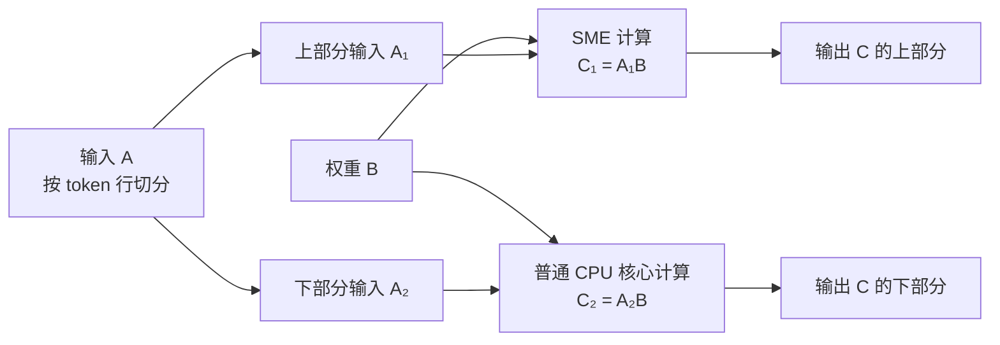
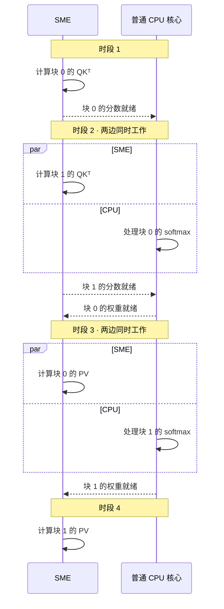
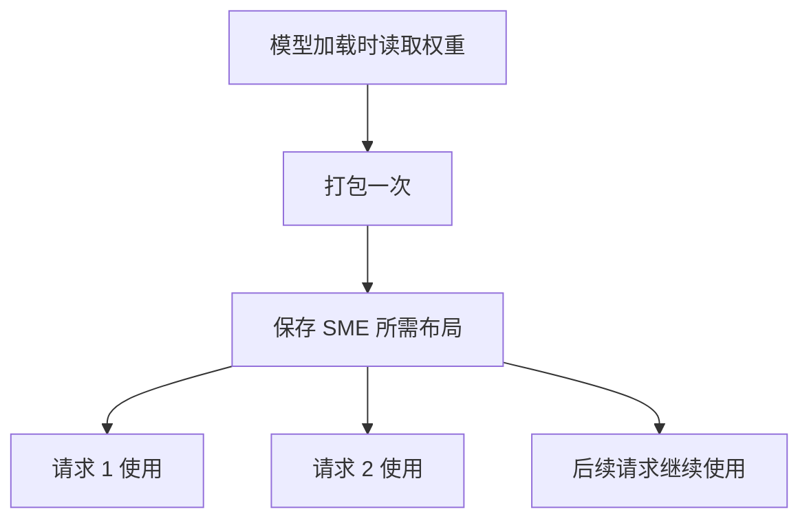
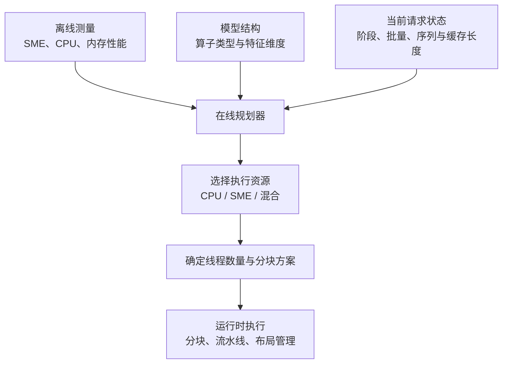
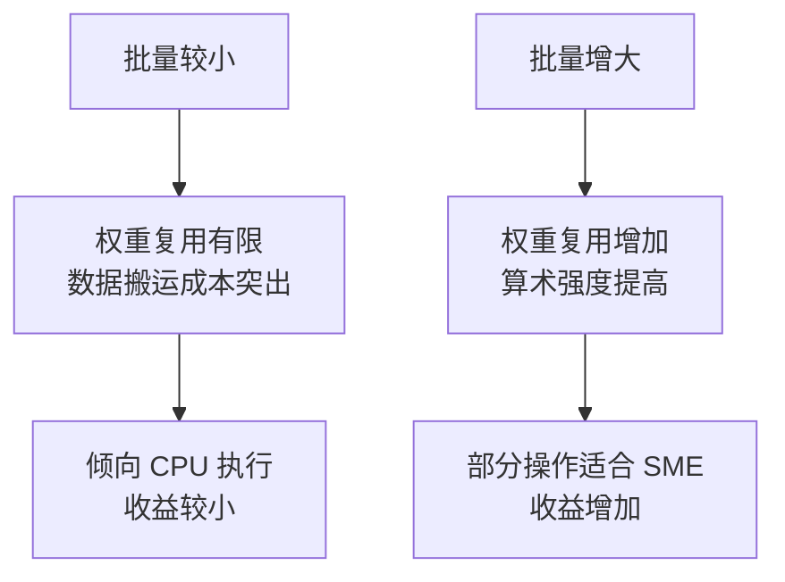
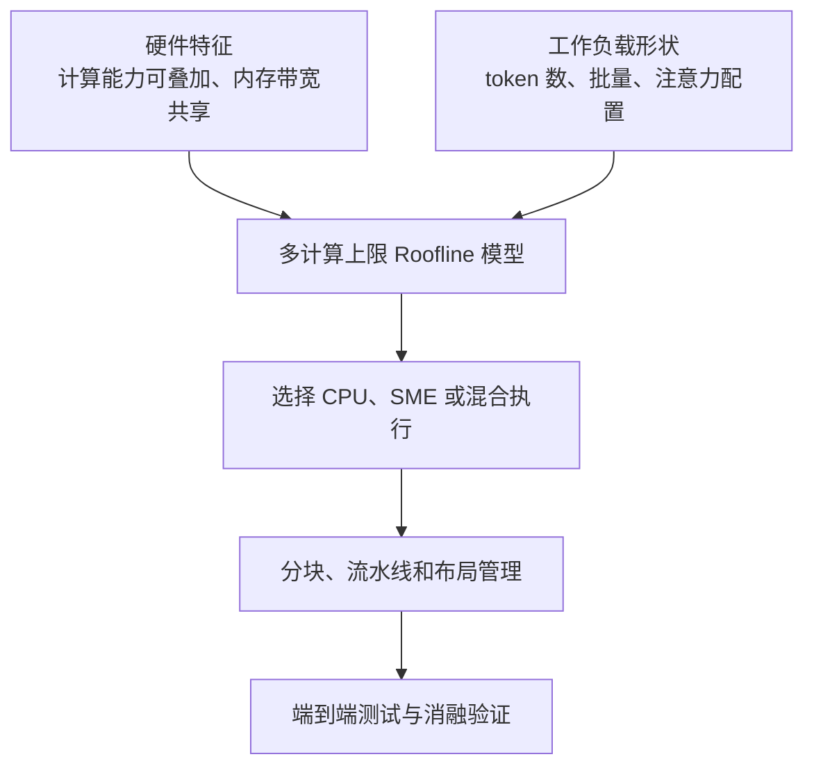

# SMEPilot 论文解读

论文下载链接：[arxiv.org/pdf/2606.16332v1](https://arxiv.org/pdf/2606.16332v1)

论文标题为 *SMEPilot: Characterizing and Optimizing LLM Inference with Scalable Matrix Extensions*，作者为 Feiyang Chen、Haibo Chen，来自上海交通大学 IPADS 实验室。

未找到开源项目地址。

## 目录

1. [整体概览](#section-1)
2. [Prefill、Decode 与性能瓶颈](#section-2)
3. [Roofline 模型与执行资源选择](#section-3)
4. [矩阵分块与工作量分配](#section-4)
5. [注意力流水线执行](#section-5)
6. [数据布局管理](#section-6)
7. [从请求到执行计划](#section-7)
8. [实验结果及其解读](#section-8)
9. [研究贡献、局限与后续方向](#section-9)

<a id="section-1"></a>

## 第一部分　整体概览

### 1.1 论文研究什么问题

这篇论文研究的核心问题是，CPU 里有了专门加速矩阵计算的 SME 单元后，怎样合理安排工作，才能让大语言模型推理更快？

作者根据任务特点，让普通 CPU 核心、SME 单元分别工作，或者协同工作，并减少它们之间的等待和数据整理开销。

本部分主要对应论文第 1–5 节。

### 1.2 先理解它在优化什么

你向大模型提问时，模型通常经历两个阶段。

- 预填充（Prefill）一次处理输入的提示词，理解上下文。
- 解码（Decode）逐步生成后续内容，通常每一步生成一个 token。可以暂时把 token 理解成模型处理文本的小单位。

这两个阶段都会涉及矩阵计算，但工作量、数据复用程度不同，所以适合的硬件执行方式也可能不同。

**SME 是 Arm 的可伸缩矩阵扩展**，提供专门的矩阵寄存器和计算指令。入门时，可以把它理解为 CPU 内部擅长矩阵计算的专用计算资源。

### 1.3 为什么把计算都交给 SME 行不通

论文强调一个关键观察，矩阵计算能力更强，也需要结合工作特征才能转化为推理加速。

可以用厨房作类比。

- 普通 CPU 核心像能处理各种工序的厨师。
- SME 像擅长批量加工的设备。
- 内存带宽像给厨房运送食材的通道。

如果有大量食材需要批量加工，专用设备很有用。如果主要时间花在等食材送来，设备再快也帮不上太多忙。此外，某些工序仍然更适合普通厨师。

对应到论文，就是以下情况。

- 大规模矩阵计算，可以充分利用 SME。
- 单 token 解码中的一些操作，主要受限于读取权重或缓存的速度。
- softmax 等操作，更适合普通 CPU 核心。

而且，**SME 和普通 CPU 核心虽然能共同提供计算能力，却共享内存带宽**。这是整篇论文的重要出发点。

### 1.4 作者主要做了哪些工作

可以分成分析规律和实现系统两层。

首先，作者建立了一个 **Roofline（屋顶线）性能模型**，判断某个操作主要受计算能力限制，还是受数据搬运速度限制。再根据操作的实际规模，选择只用普通 CPU 核心、只用 SME，或同时使用两者。

这里的操作，也叫**算子**，可以理解为模型中的一个计算步骤，例如一次矩阵乘法。同一个算子在输入规模变化后，执行方式也可能随之变化。

然后，作者实现了推理引擎 **SMEPilot**，用三个关键设计把上述判断落实。

| 设计         | 入门理解                                                                       |
| ------------ | ------------------------------------------------------------------------------ |
| 分块分工     | 把大矩阵计算拆成小块，让 SME 和普通 CPU 核心共同计算，尽量一起完成             |
| 流水线执行   | 让 SME 计算后续数据块时，CPU 同时处理前面数据块的 softmax 等操作，减少相互等待 |
| 数据布局管理 | 提前整理、重复利用 SME 需要的数据排列方式，减少每次计算前重新整理数据的开销    |

所以，这篇论文的贡献包括性能分析、执行策略，以及让策略真正产生收益的运行时设计。

### 1.5 最终效果怎样

论文在手机、个人电脑和服务器平台上，使用 Llama、Qwen 等模型评估。相对于所采用的 **llama.cpp CPU 基线**，报告的**最高端到端加速比为 3.94 倍**。

不同设备、模型和任务的收益不同。论文也报告，小批量、强内存带宽限制的场景中，性能可能与基线接近。

学习时可以沿着这条主线理解全文。

**先判断瓶颈 → 决定由谁计算 → 通过分块、流水线和数据布局减少浪费。**

这属于大模型推理系统与计算机体系结构交叉方向的研究，重点是如何更高效地使用硬件执行模型。

<a id="section-2"></a>

## 第二部分　Prefill、Decode 与性能瓶颈

大模型读题和作答时，计算方式不同，运行慢也可能有不同原因。

我们用一个例子贯穿说明。

> 输入“请解释一下什么是机器学习。”
>
> 模型开始生成“机器学习是……”

### 2.1 Prefill 一次处理已有的输入

模型先把问题转换成一串 token。token 是模型处理文本的基本单位，可能是一个字、一个词，或词的一部分。

在预填充阶段，模型会处理这些输入 token，计算各层的中间结果，并建立后续生成需要的 **KV 缓存（KV Cache）**。

现在可以把 KV 缓存理解为，保存已经处理过的内容所对应的部分计算结果，供后续生成复用。它的具体结构与注意力机制有关。

Prefill 的特点是，**输入中的多个 token 可以放在一起进行矩阵计算**。

例如，一段输入有 1,000 个 token，某个线性层就可以把它们的表示组织成一个矩阵，一起与权重矩阵相乘。虽然模型内部仍有层与层之间的依赖，但处理输入时有大量计算可以并行展开。

这为 SME 这样的矩阵计算资源提供了发挥空间。

### 2.2 Decode 利用已有上下文逐步生成

处理完输入后，模型产生第一个输出 token。随后，它把这个新 token 纳入上下文，再预测下一个 token，如此反复。

对于普通的自回归生成过程，可以粗略理解为

> 已有上下文 → 预测一个 token → 更新上下文 → 再预测一个 token。

因为下一个 token 依赖前面生成的结果，未来输出需要逐步确定。

对于单个请求、每步生成一个 token 的常见情况，每一步只新增一个 token 的计算，但仍需要读取大量模型权重，并利用已有的 KV 缓存完成注意力计算。

Decode 会复用 KV 缓存，避免为每个新 token 从头重新计算整个历史的 K、V。

### 2.3 两个阶段为什么可能遇到不同瓶颈

先用一个简化的线性层说明。线性层的主要计算可以写成

$$
Y=XW
$$

其中，$X$ 是输入，$W$ 是模型权重，$Y$ 是输出。

假设权重矩阵 $W$ 很大。

| 场景                         | 输入的形状        | 同一份权重能服务多少输入            |
| ---------------------------- | ----------------- | ----------------------------------- |
| Prefill，处理 1,000 个 token | $X$ 有 1,000 行 | 一次矩阵运算中，可供很多 token 复用 |
| 单请求、单 token Decode      | $X$ 只有 1 行   | 这一轮只为一个新 token 计算         |

两种情况都需要读取权重，但读入权重之后，能够完成的计算量差别很大。

Prefill 通常能用同一份权重做更多计算。单 token Decode 则经常需要读取很多数据，却只完成相对少量的计算。

### 2.4 计算受限

想象厨房的食材供应充足，但厨师切菜速度跟不上。此时增加加工设备，就可能明显提速。

对应到计算机，就是数据能够及时送到计算单元，但需要完成的运算太多，计算单元忙不过来。这叫**计算受限（Compute-bound）**。

大规模 Prefill 矩阵乘法往往更容易进入这种状态。因此，SMEPilot 会考虑让 SME 和普通 CPU 核心共同承担矩阵计算，提高总计算能力。

### 2.5 内存带宽受限

如果食材运输通道每秒只能送来固定数量的食材，那么增加加工设备，也无法让厨房持续加工更多食材。

对应到计算机，就是计算单元本来可以算得更快，但数据从内存送来的速度跟不上。这叫**内存带宽受限（Memory-bound）**。内存带宽可以理解为单位时间能搬运多少数据。

单 token Decode 中的权重读取，经常容易出现这种情况。此时，SME 的矩阵计算能力需要受到数据供应速度的约束。

### 2.6 算术强度

论文使用的一个关键指标是**算术强度（Arithmetic Intensity）**。

$$
\text{算术强度}=\frac{\text{计算量}}{\text{数据搬运量}}
$$

它衡量每搬运一个字节的数据，能完成多少计算。

- 算术强度低，搬运很多数据，只做少量计算，更容易受内存带宽限制。
- 算术强度高，搬进来的数据可以反复参与计算，更有机会发挥计算单元的能力。

高低是相对于硬件能力而言的。同一个操作，在普通 CPU 核心上可能已经算不过来，在算力更强的 SME 上却可能变成等数据。这是论文建立多条计算上限的 Roofline 模型的原因。

Prefill 通常有更强的数据复用和矩阵并行机会，单 token Decode 通常更容易受数据搬运限制。实际情况还会受到批量大小、算子类型和上下文长度的影响。

<a id="section-3"></a>

## 第三部分　Roofline 模型与执行资源选择

### 3.1 性能受到两条上限约束

一个操作的运行速度，到底被计算能力卡住，还是被数据供应速度卡住？

假设某种执行方式的最大计算速度是 $P$，内存带宽是 $B$，操作的算术强度是 $I$。它的性能会受到两条上限约束。

- **计算上限 $P$**，硬件每秒最多完成多少运算。
- **数据供应形成的上限 $B\times I$**，每秒能搬运多少数据，乘以每字节数据能够支持多少运算。

Roofline 模型用下面的公式估计可达到的性能。

$$
R=\min(P,\;B\times I)
$$

这里的 $\min$ 就是取较小值，两条上限中较低的那条限制了速度。

例如，假设计算能力是每秒 1 万亿次运算，内存带宽是每秒 100 GB，每搬运 1 字节数据可以完成 2 次运算。那么数据供应只能支持

$$
100\ \text{GB/s}\times 2\ \text{次/字节}=2000\ \text{亿次/秒}
$$

尽管硬件能算得更快，模型预测的性能上限仍然只有每秒 2000 亿次运算。

### 3.2 为什么叫屋顶线

如果横轴是算术强度 $I$，纵轴是性能，那么算术强度低时，性能上限随 $B\times I$ 上升，是一条斜线。算术强度足够高后，上限达到 $P$，变成一条水平线。

两段连接起来，像一个先倾斜、再变平的屋顶。

转折处叫**拐点（ridge point）**，满足

$$
I_{\text{ridge}}=\frac{P}{B}
$$

它表达的是，要让计算单元充分忙起来，每搬运一字节数据，至少需要有多少计算可以做。算力越强，在带宽不变的情况下，需要的算术强度就越高。

### 3.3 为什么需要多个计算上限

SMEPilot 要在三种执行方式之间选择。

| 执行方式 | 计算资源                    |
| -------- | --------------------------- |
| CPU-only | 普通 CPU 核心               |
| SME-only | SME 矩阵计算资源            |
| 混合执行 | SME 与普通 CPU 核心共同计算 |

论文测得，对于有足够独立工作的矩阵运算，SME 与普通 CPU 核心的计算吞吐可以接近相加，但两者共享内存带宽。

因此，模型有三个不同的计算上限，却使用同一个带宽上限。

$$
R_h=\min(P_h,\;BI)
$$

其中 $h$ 表示所选择的执行方式。可以把它理解为，加工设备的组合变了，食材运输通道的宽度没有增加。

### 3.4 三个区域对应三类策略

下面用一组便于理解的**假设数字，非论文实测数据**说明。

- CPU 计算上限为 $1$ TFLOP/s。
- SME 计算上限为 $3$ TFLOP/s。
- 混合执行上限为 $4$ TFLOP/s。
- 共享带宽为 $100$ GB/s。

由此得到 CPU 和 SME 的拐点，分别为 $10$ 和 $30$ FLOP/Byte。

| 算术强度示例 | CPU 性能上限 | SME 性能上限 | 混合性能上限 | 含义                               |
| ------------ | -----------: | -----------: | -----------: | ---------------------------------- |
| $I=5$      |  0.5 TFLOP/s |  0.5 TFLOP/s |  0.5 TFLOP/s | 都受带宽限制                       |
| $I=20$     |    1 TFLOP/s |    2 TFLOP/s |    2 TFLOP/s | CPU 算力不足，SME 已能触及带宽上限 |
| $I=50$     |    1 TFLOP/s |    3 TFLOP/s |    4 TFLOP/s | 有足够计算，可以利用混合算力       |

#### 算术强度低时通常优先 CPU

大家都在等数据，增加算力无法提高模型中的性能上限。论文还观察到，此类工作中普通 CPU 核心往往能更有效地利用内存，因此倾向于选择 CPU。

常见例子是单 token Decode 中的矩阵向量乘法。

#### 算术强度居中时通常优先 SME

CPU 的计算能力已经成为瓶颈，SME 可以把性能进一步推高，直到碰到共享带宽上限。此时再让普通 CPU 核心加入计算，也难以突破带宽限制。

论文称这个区域为 **ridge-crossing**。可以理解为，同一个操作已经越过 CPU 的拐点，却还没有越过 SME 的拐点。部分批量 Decode 操作会落在这个区域。

#### 算术强度高时可以考虑混合执行

数据复用足够充分，SME 单独执行也受到计算能力限制。此时加入普通 CPU 核心，有机会进一步提速。

典型例子是大规模 Prefill 矩阵乘法。要获得收益，还必须有足够多的独立计算块，能够合理分给两边。

### 3.5 模型与实际开销

Roofline 是性能上限模型，实际速度还受任务调度、数据布局转换、线程竞争和同步等开销影响。

矩阵算力也需要结合操作类型解释。对于 softmax 等向量操作，论文根据实际性能特征选择普通 CPU 核心。

SMEPilot 利用模型判断执行方向，再结合硬件测量、操作规模和可用分块，生成具体计划。数据供不上时，额外算力帮忙有限。数据复用充分时，SME 才更容易发挥作用，甚至值得让 SME 和普通 CPU 核心一起计算。

<a id="section-4"></a>

## 第四部分　矩阵分块与工作量分配

对于适合混合执行的大矩阵乘法，SMEPilot 会把不同的输出块分给 SME 和普通 CPU 核心，并按双方速度分配工作量，让它们尽量同时完成。这对应论文第 4.1 节和第 4.4 节。

### 4.1 哪些部分可以独立计算

先看模型中常见的线性层计算。

$$
C_{M\times N}=A_{M\times K}B_{K\times N}
$$

| 符号  | 在线性层中的含义          |
| ----- | ------------------------- |
| $M$ | 本次处理的 token 数量     |
| $K$ | 每个 token 的输入特征数量 |
| $N$ | 每个 token 的输出特征数量 |

输出 $C$ 有 $M$ 行、$N$ 列。每个元素的计算为

$$
C_{ij}=\sum_{k=1}^{K}A_{ik}B_{kj}
$$

也就是，取 $A$ 的第 $i$ 行与 $B$ 的第 $j$ 列，对应相乘再求和。

输出中的不同元素可以独立计算。比如，计算第一行输出时，可以与计算第二行输出同时进行。

SMEPilot 利用这个性质，把输出划成小矩形块，也就是 **tile**，再分配给不同计算资源。

### 4.2 沿 token 方向切分

下面是按 $M$ 维度切分的示意图。上下两部分使用同一份权重 $B$，分别产生输出的上下两部分。



例如，有 1,000 个 token，可以让 SME 负责其中一部分 token 的完整输出，普通 CPU 核心负责其余 token 的完整输出。

每一边都能独立写入自己负责的输出区域。

### 4.3 沿输出特征方向切分

还可以按 $N$ 维度切分，让两边处理相同的 token，但计算不同的输出特征。

数学上表示为

$$
B=[B_1\;\;B_2]
$$

$$
C=[AB_1\;\;AB_2]
$$

此时，SME 计算输出的左半区域，普通 CPU 核心计算右半区域。两边共享输入 $A$，各自使用对应的权重列。

论文根据矩阵形状选择切分方向。$M$ 较大时沿 $M$ 切，$N$ 较大时沿 $N$ 切，以便形成更适合内核处理的分块，并改善缓存局部性。

### 4.4 为什么选择输出维度

观察元素计算公式，如果沿 $K$ 切分，SME 和 CPU 算出的就会是同一个输出元素的部分和。

比如，SME 累加前一段 $k$，CPU 累加后一段 $k$，最后还要把两份结果相加。这个合并过程称为**归约（reduction）**，会增加同步和数据访问开销。

沿 $M$ 或 $N$ 切分时，每个输出元素由一方完整计算，可以避免这种跨资源的部分和归约。

### 4.5 按双方速度分配工作量

假设 SME 的速度是普通 CPU 核心合计速度的三倍。如果各分一半工作，CPU 侧就会花更长时间，SME 算完后需要等待。

下面用假设数字说明。总工作量为 120 个等量计算块，SME 每毫秒处理 3 块，CPU 侧每毫秒处理 1 块。

| 分配方案                   | SME 完成时间 | CPU 完成时间 | 整个操作完成时间 |
| -------------------------- | -----------: | -----------: | ---------------: |
| 各分 60 块                 |        20 ms |        60 ms |            60 ms |
| SME 分 90 块，CPU 分 30 块 |        30 ms |        30 ms |            30 ms |

整个操作需要等两边完成，因此分配比例应考虑双方的处理速度。

论文中，分给 SME 的理想比例为

$$
\rho=\frac{P_{\mathrm{SME}}^{\mathrm{eff}}}{P_{\mathrm{SME}}^{\mathrm{eff}}+P_{\mathrm{CPU}}^{\mathrm{eff}}}
$$

这里的 $P^{\mathrm{eff}}$ 是性能测量得到的有效吞吐率，与所用内核及工作线程数量有关。若 SME 的有效吞吐率是 CPU 侧的三倍，就得到

$$
\rho=\frac{3}{3+1}=75\%
$$

### 4.6 切分还要符合内核要求

优化过的矩阵内核通常按固定形状处理数据。例如，某个内核可能要求分界落在特定行数或列数的整数倍上。

SMEPilot 会先计算理想比例，再把切分位置调整到双方内核支持的对齐边界。如果有几个接近的候选位置，就比较预计完成时间，选择让较慢一侧尽早完成的方案。

它还会检查工作量是否足够支撑所选线程数量。分给某个线程的区域过小，或者无法满足分块对齐要求时，就减少线程。

这解释了论文图 5 中的两种分工方式，以及公式（1）为什么按有效吞吐率确定比例。

<a id="section-5"></a>

## 第五部分　注意力流水线执行

注意力计算包含几种性质不同的工作。SMEPilot 让 SME 处理矩阵阶段，让普通 CPU 核心处理 softmax 等向量阶段，并让不同数据块的这些阶段重叠执行。这对应论文第 4.2 节和图 6。

### 5.1 注意力计算的三个阶段

注意力让一个 token 根据上下文中的相关内容，更新自己的表示。它的主要计算可以简化为

$$
S=\frac{QK^\top}{\sqrt d}
$$

$$
P=\operatorname{softmax}(S+\text{mask})
$$

$$
O=PV
$$

暂时不用深入 $Q、K、V$ 如何产生，先理解它们在这里的作用。

| 阶段           | 直观含义                         | 主要计算特点                 |
| -------------- | -------------------------------- | ---------------------------- |
| $QK^\top$    | 计算当前位置与其他位置的相关分数 | 矩阵乘法                     |
| softmax 等处理 | 把有效位置的分数转换成权重       | 指数、求和、归一化等向量操作 |
| $PV$         | 按这些权重汇总信息               | 矩阵乘法                     |

其中，mask 决定哪些位置可以参与注意力。例如，生成文本时，一个位置只能关注允许访问的历史位置。

对论文研究的适合 SME 的注意力形状，两个矩阵阶段交给 SME，softmax 等阶段交给普通 CPU 核心。


### 5.2 整个阶段做完才交接会出现等待

假设先算完所有数据的 $QK^\top$，再统一做 softmax，最后统一计算 $PV$。

| 执行阶段               | SME          | 普通 CPU 核心    |
| ---------------------- | ------------ | ---------------- |
| 所有数据的 $QK^\top$ | 工作         | 等待这部分结果   |
| 所有数据的 softmax     | 等待处理结果 | 工作             |
| 所有数据的 $PV$      | 工作         | 这部分工作已完成 |

硬件之间有交接，但缺少重叠。论文把这样的空闲时段称为 **bubble**，可以理解为流水线中的气泡。

### 5.3 按数据块交接

把注意力工作划成多个满足依赖要求的数据块。每个块仍按下面的顺序推进。

$$
QK^\top\rightarrow\text{softmax}\rightarrow PV
$$

块 0 的分数准备好后，CPU 就可以处理块 0，同时 SME 开始计算块 1。

下面用两个块说明。**各时间段长度仅用于展示调度关系，并非论文实测耗时。**图中的每个块代表能够按所需依赖完成相应注意力处理的工作块。



观察中间两个时段，SME 和 CPU 都在做有用的工作。虽然一个块内部仍有先后依赖，不同块之间可以交错推进。

图中的 $QK^\top$ 和 $PV$ 使用同一侧 SME 资源，因此也需要安排它们之间的执行顺序。

### 5.4 块大小为什么需要选择

块小，CPU 能更早拿到第一份结果，重叠机会更多，但任务交接更频繁，矩阵内核也可能难以充分发挥效率。

块大，每次矩阵计算更充分，但 CPU 需要等更久才能开始处理，流水线启动和收尾时的等待也可能更长。

SMEPilot 结合离线性能测量和当前请求形状，估算矩阵阶段与 softmax 阶段的时间，选择满足矩阵内核对齐要求、又能减少长时间等待的块形状。

论文还利用注意力掩码，跳过被完全屏蔽的矩阵块，减少进入流水线的无效计算。

前一部分的分块分工，让双方参与同一次矩阵运算。这里的流水线则让双方同时推进不同数据块中各自擅长的阶段。

<a id="section-6"></a>

## 第六部分　数据布局管理

SME 内核需要以合适的顺序读取数据，才能高效计算。SMEPilot 因此把数据在内存中的排列方式也纳入运行时管理，尽量让整理好的数据被后续计算反复利用。这对应论文第 4.3 节和图 7。

### 6.1 数据布局是什么

数学上的矩阵是二维的，但内存里的数据按地址排列。以一个小矩阵为例。

$$
A=\begin{bmatrix}
a&b&c&d\\
e&f&g&h\\
i&j&k&l\\
m&n&o&p
\end{bmatrix}
$$

常见的**行优先布局**会按行存放。

```text
a b c d | e f g h | i j k l | m n o p
```

如果计算内核按小矩形块处理数据，就可能更适合把同一块中的元素放在一起。例如，按 $2\times2$ 块排列可以写成

```text
a b e f | c d g h | i j m n | k l o p
```

这是一幅简化示意。论文中的实际排列还取决于 SME 向量长度和内核要求。

把数据转换成内核需要的排列方式，叫作 **packing**，通常译为打包。转换后，矩阵元素的逻辑位置和值保持对应关系，内核按约定读取它们。

### 6.2 打包为什么影响加速效果

打包需要读取原数据、重新排列，再写入目标位置，因此会消耗时间和内存带宽。

一次 SME 调用的耗时，可以粗略拆成

$$
T_{\text{总}}=T_{\text{打包}}+T_{\text{计算}}+T_{\text{其他开销}}
$$

如果每次调用前都重新打包，即使计算很快，整理数据也可能成为主要开销。对于本来就受数据搬运限制的操作，这个问题尤其突出。

论文用两种方式处理它，分别针对静态权重和运行时生成的数据。

### 6.3 静态权重在模型加载时打包一次

模型权重在推理过程中通常保持固定，因此可以在模型加载阶段，把需要由 SME 消费的权重打包好，之后复用。



用户提交请求后，必须等待完成的那些步骤，会直接影响响应时间。把权重打包移到加载阶段，可以减少每次请求需要等待的工作。这是在减少请求关键路径上的开销。

### 6.4 动态数据在产生时按需要的布局写入

激活值是模型运行时产生的中间数据，无法全部提前准备。SMEPilot 会在下游需要 SME 布局时，尽量让上游产生数据的步骤直接写出所需布局。

KV 缓存是论文的重要例子。每生成一个新 token，就会产生新的 K、V 数据，并在后续注意力计算中继续使用。

如果每次注意力调用前，都把已有 KV 缓存重新整理一遍，历史数据就会被反复搬运。


随着生成继续，缓存中已经保存的历史条目可以继续复用，只需处理新增条目的写入。

论文还为 K 和 V 分别设计了合适的缓存布局，因为它们在 $QK^\top$ 和 $PV$ 两次矩阵乘法中的访问方式不同。

### 6.5 运行时如何判断是否需要转换

SMEPilot 跟踪张量当前的布局，并让计算任务声明自己接受什么布局、输出什么布局。

例如，上游已经产生 SME 所需的布局，下游就直接使用。只有生产者给出的布局与消费者要求不兼容时，运行时才插入转换。

这让布局选择与算子执行计划联系起来。决定一个算子交给 SME 时，还需要考虑它能否直接使用已有数据，以及打包结果能否被后续计算复用。

三个主要运行时设计分别处理不同开销。分块分工提高并行利用率，流水线减少阶段间等待，布局管理减少重复数据整理。

<a id="section-7"></a>

## 第七部分　从请求到执行计划

一次请求进入 SMEPilot 后，系统会结合硬件的实测能力、模型结构和当前计算形状，为各个算子生成执行计划。论文图 8 展示了整体结构，第 4.4 节说明了规划过程。

### 7.1 离线测量硬件能力

同样支持 SME，不同芯片的计算能力、普通 CPU 核心数量和内存带宽也会不同。SMEPilot 先通过离线测试，测量规划需要的参数。

| 测量对象      | 主要参数                       |
| ------------- | ------------------------------ |
| SME           | 单元数量、矩阵和向量计算吞吐率 |
| 普通 CPU 核心 | 核心数量、矩阵和向量计算吞吐率 |
| 存储系统      | 内存带宽、缓存容量             |

离线表示这些测试可以提前执行。得到的硬件性能数据可以供不同模型和请求使用。

### 7.2 在线分析这次实际要算什么

用户请求到来后，规划器结合模型和请求状态，分析各个算子的形状、计算量和数据访问量。

对于线性层 $C_{M\times N}=A_{M\times K}B_{K\times N}$，模型通常决定特征维度 $K、N$，而当前处理的 token 数量会影响 $M$。长提示词的 Prefill、单 token Decode、批量 Decode，会形成不同的矩阵形状。

规划器据此估算算术强度，再结合 Roofline 模型判断执行方向。



### 7.3 执行计划需要决定三件事

首先是**选择计算资源**。内存带宽受限或向量计算为主的操作倾向于 CPU。能从 SME 算力获益的矩阵操作可以使用 SME。计算量大、独立输出块充足时，可以选择混合执行。

其次是**分配线程**。规划器检查当前工作量能否支撑候选线程。如果某个线程分到的区域太小，或者破坏内核要求的分块对齐，就减少线程。

最后是**确定分块形状与比例**。对于混合执行，规划器依据双方有效吞吐率计算理想分工比例，再调整到合法的分块边界，比较两侧预计完成时间。

一份计划包含资源选择、参与线程数量、切分方向，以及双方各处理多少工作。

### 7.4 同一个线性层可以得到不同计划

下面是论文描述的典型趋势。具体选择仍取决于硬件测量和实际形状。

| 当前场景                | 计算特征                              | 可能的计划                       |
| ----------------------- | ------------------------------------- | -------------------------------- |
| 长提示词 Prefill        | token 多，权重复用充分，独立计算块多  | SME 与 CPU 混合执行              |
| 单请求、单 token Decode | 矩阵很薄，读取权重的成本突出          | CPU 执行                         |
| 较大批量 Decode         | 多个 token 共同使用权重，算术强度提高 | SME 执行，形状足够大时也可能混合 |

例如，一个 FFN 线性层在处理长输入时，可以由双方共同完成。进入单 token Decode 后，同一层可能改由普通 CPU 核心执行。若同时处理更多请求，矩阵变宽，规划结果又可能变化。

MoE 模型中，规划器还会考虑每个专家实际收到的 token 数量。收到少量 token 的专家和收到大量 token 的专家，可能采用不同执行方式。

### 7.5 运行时落实计划

- **分块执行**按计划把输出区域交给 SME 和 CPU。
- **注意力流水线**在依赖允许时，重叠矩阵阶段与向量阶段。
- **布局管理**检查数据能否直接供内核使用，并复用预先打包的权重或缓存。

这里体现了性能模型与系统实现之间的联系。模型预测混合执行有收益，运行时就需要提供独立分块和合理负载分配。模型预测 SME 有收益，运行时也需要控制数据转换和等待开销。

<a id="section-8"></a>

## 第八部分　实验结果及其解读

论文用三层实验检验 SMEPilot，分别考察完整推理是否加速、具体算子为何加速、各项设计贡献了多少收益。以下数据来自第 5 节，主要对应图 9–12。

### 8.1 实验覆盖了什么

作者在 Apple M4 Pro、天玑 9500、鲲鹏 920 72F8 三个平台上测试，模型包括 Llama-3.2-3B、Qwen3-4B 和 Qwen3-30B-A3B。其中，Qwen3-30B-A3B 使用 4 位权重量化，以适应设备内存。

端到端测试采用三类任务，让 Prefill 和 Decode 在总耗时中占据不同的比重。

| 任务                  | 输入与输出特点                              | 主要考察什么         |
| --------------------- | ------------------------------------------- | -------------------- |
| Ruler 长上下文问答    | 输入约 3,324 或 7,338 个 token，输出约 4 个 | Prefill 性能         |
| GSM8K 数学问答        | 输入约 92 个 token，输出约 100 个           | 不同批量下的推理性能 |
| LongWriter 长文本生成 | 输入约 339 个 token，输出约 5,424 个        | 长时间 Decode 性能   |

这些数字是论文报告的平均 token 数。部分设备、模型和批量组合因内存限制没有测试。

### 8.2 怎样读端到端结果

端到端基线是 **llama.cpp 的默认 CPU 后端**。加速比的计算方式为

$$
\text{加速比}=\frac{T_{\text{基线}}}{T_{\text{SMEPilot}}}
$$

例如，加速比为 2，表示完成相同任务的时间降为基线的一半。

| 比较范围     | 论文报告的加速比 |
| ------------ | ---------------: |
| 完整推理     |     最高 3.94 倍 |
| Prefill 阶段 |    1.13–5.42 倍 |
| Decode 阶段  |     最高 3.48 倍 |

读图 9 时，可以先看每个小图中的设备和模型，再看横轴上的输入长度或批量，最后比较两种系统的总延迟以及 Prefill、Decode 各自的部分。

### 8.3 收益如何随工作负载变化

GSM8K 的实验提供了一个容易理解的例子。

批量为 1 或 2 时，SMEPilot 与基线性能接近。作者解释，此时许多操作受内存带宽限制，规划器会选择 CPU 执行。

批量增大后，多个 token 能复用同一份权重，矩阵形状和算术强度发生变化，部分操作进入适合 SME 的区域，加速收益随之增加。



这是实验结果与前面 Roofline 分析相互对应的地方。执行策略随着形状变化，收益也随之变化。

### 8.4 算子实验回答更具体的问题

作者进一步在 M4 Pro 上单独测试 FFN 和注意力。

| 测试对象             | 对比对象                               |  报告的加速比 |
| -------------------- | -------------------------------------- | ------------: |
| Prefill FFN 矩阵乘法 | GGML CPU                               | 6.06–7.43 倍 |
| Prefill FFN 矩阵乘法 | Apple Accelerate、KleidiAI 的 SME 实现 | 1.30–1.67 倍 |
| Prefill 注意力       | CPU FlashAttention 基线                | 1.56–3.50 倍 |

与已有 SME 实现的比较尤其值得关注。双方都能利用 SME，SMEPilot 仍获得额外收益，这与它把普通 CPU 核心也纳入矩阵分工的设计相吻合。

注意力测试则检验了整个优化实现的效果。要进一步判断流水线本身的贡献，需要看消融实验。

### 8.5 消融实验拆解各项贡献

消融实验会关闭或替换系统中的某项机制，再观察性能变化。论文图 12 针对三个设计，分别选择了一个代表性算子进行测试。

| 改动                                 | 完整方案延迟 | 改动后延迟 | 改动后变慢 |
| ------------------------------------ | -----------: | ---------: | ---------: |
| 关闭分块分工，测试 GEMM              |     48.25 ms |    70.6 ms | 约 1.46 倍 |
| 关闭流水线，测试 Prefill 注意力      |      98.1 ms |   202.7 ms | 约 2.07 倍 |
| 改为调用前直接打包，测试 Decode GEMV |      0.52 ms |    1.71 ms | 约 3.29 倍 |

三行分别对应前面学过的三个问题。

- 分块分工让 SME 和 CPU 共同承担计算，关闭后损失一部分可用算力。
- 流水线让不同块的矩阵与向量阶段重叠，关闭后等待时间增加。
- 布局管理减少重复打包，把打包放回调用路径后，数据整理成本明显增加。

这些倍数来自不同算子的独立测试，不能直接相乘用来计算整机加速比。

### 8.6 局部加速如何影响完整推理

完整推理包含许多步骤，某个算子的大幅加速会被其他步骤的耗时稀释。

用一组假设数字说明。原本一次推理耗时 10 秒，其中目标算子占 6 秒，其余步骤占 4 秒。即使目标算子加速 6 倍，总耗时也变成

$$
T_{\text{新}}=\frac{6}{6}+4=5\ \text{秒}
$$

整体加速比是 $10/5=2$ 倍。

论文中算子级别的 7 倍左右加速，与端到端最高 3.94 倍可以同时成立。理解实际收益，需要结合该算子在整个任务中的耗时占比。

<a id="section-9"></a>

## 第九部分　研究贡献、局限与后续方向

这篇论文把 SME 的硬件特征、LLM 的计算形状和运行时调度联系起来。实验结论也有明确的适用范围，需要结合平台、基线和工作负载理解。本部分结合论文第 3–7 节分析。

### 9.1 有价值的研究认识

作者抓住了两项同时存在的硬件特征。

- 对足够大的矩阵工作，SME 和普通 CPU 核心可以提供接近相加的计算吞吐。
- 两者共享内存带宽，混合执行无法同比增加数据供应能力。

由此，同一个逻辑算子会因形状不同而适合不同执行方式。



这条链条把硬件能做什么，推进到了推理系统怎样利用它。

### 9.2 方法上的贡献

| 层次       | 论文的贡献                                 | 对应解决的问题               |
| ---------- | ------------------------------------------ | ---------------------------- |
| 性能分析   | 共享带宽、多计算上限的 Roofline 模型       | 什么形状值得使用 SME         |
| 执行规划   | 根据当前算子形状选择资源，并确定线程和分块 | 工作怎样分配                 |
| 运行时实现 | 分块协作、注意力流水线、布局状态管理       | 怎样减少闲置、等待和重复搬运 |

几个组成技术各有已有研究基础。评价这篇系统论文时，应关注作者如何围绕 SME 与普通 CPU 核心协同，把这些机制组织成完整的推理方案。

### 9.3 实验已经支持哪些结论

- 在测试的平台和工作负载上，SMEPilot 相比所选 CPU 基线可以改善完整推理性能。
- 对部分大型矩阵算子，混合执行比已有 SME 实现获得更高吞吐。
- 在代表性算子上，移除分块或流水线、引入重复打包，都会明显增加延迟。
- 批量与形状变化会影响收益，小批量场景可能接近基线性能。

其中，消融实验把性能变化与具体机制联系起来，帮助解释端到端结果的来源。

### 9.4 需要保留判断的地方

以下是根据实验设置和方法描述作出的评估，属于讲解中的分析。

#### 最高加速比描述的是最佳测试点

最高 3.94 倍说明某个被测配置取得了这一收益。判断自己关心的场景时，需要找到对应的设备、模型、输入长度和批量，查看那一组结果。

#### 端到端收益包含多项变化的共同作用

端到端对比采用 llama.cpp 默认 CPU 后端。SMEPilot 同时引入 SME 内核、执行规划和运行时优化，因此端到端倍数反映整套系统的收益。

论文通过 SME 算子基线和机制消融进一步拆解贡献，但在线规划器本身还能否胜过其他调度策略，仍值得更系统地比较。

#### 规划器采用启发式方法

论文根据 Roofline、实测吞吐、线程数量和对齐条件生成计划。这样的设计有利于快速规划。

要判断它距离最佳计划还有多远，可以在代表性形状上，与更充分的搜索结果比较。这会帮助量化规划质量与规划开销之间的取舍。

#### 服务器测试的规模有限

论文在鲲鹏服务器上使用 10 个线程进行比较。这个设置展示了所选资源配置下的性能。扩展到更多核心后，缓存竞争、带宽饱和以及任务划分都可能变化，需要相应测量。

### 9.5 作者提出的后续方向

论文第 7 节讨论了几项硬件和系统层面的改进机会。

| 方向                              | 原因                                         |
| --------------------------------- | -------------------------------------------- |
| 改善向量操作和 GEMV 类工作的支持  | Decode、softmax 等工作难以充分利用矩阵吞吐   |
| 降低布局转换成本                  | 更快的矩阵内核可能被数据整理开销抵消         |
| 改善 SME 与普通核心之间的资源隔离 | 计算并发仍会受到共享缓存和指令发射等因素影响 |
| 与 GPU、NPU 协同                  | 需要进一步考虑数据传输、内存放置和跨设备调度 |

GPU、NPU 协同被作者列为未来工作。当前论文的主要调度范围，是具备 SME 的 CPU 内部。

读到这里，已经可以从研究者的角度追问这篇论文。模型是否解释了现象，运行时是否实现了模型预测的机会，实验是否逐项验证了这些设计？

## 当前学习进度

已完成整体概览、基础概念、Roofline 分析、三个运行时机制、执行计划生成、实验解读，以及研究贡献与局限分析。
